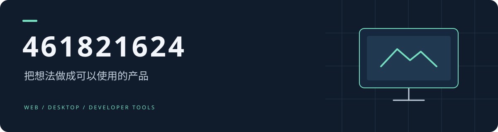

  

Web · Desktop · Developer Tools

  <a href="https://github.com/461821624?tab=repositories">浏览项目</a> ·
  <a href="https://github.com/461821624?tab=stars">收藏与探索</a>

## 项目入口

| 项目 | 入口 |
| --- | --- |
| nest-vite-electron | [查看仓库](https://github.com/461821624/nest-vite-electron) |
| CreateLED-Chat | [查看仓库](https://github.com/461821624/CreateLED-Chat) |
| FrameScript | [查看仓库](https://github.com/461821624/FrameScript) |
| CodeLayer | [查看仓库](https://github.com/461821624/CodeLayer) |
| luma-notes | [查看仓库](https://github.com/461821624/luma-notes) |

---

从一个想法开始，做到可以使用。

